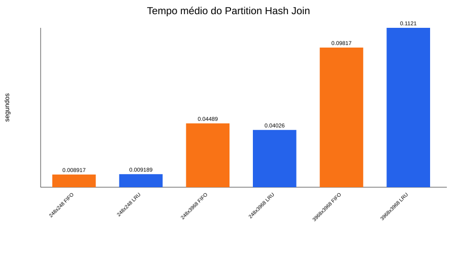
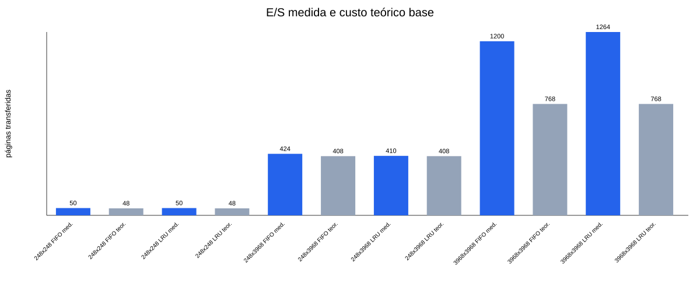

# Resultados do Partition Hash Join

Fonte: `results/partition_hash_join_10_repeticoes.csv`.

Estabilidade: coeficiente de variação menor ou igual a 5.0%.

| R | S | Política | Repetições válidas | Média s | CV % | Estável | E/S medida | E/S teórica | Razão | Repartições | Fallback |
|---:|---:|---|---:|---:|---:|---|---:|---:|---:|---:|---:|
| 248 | 248 | FIFO | 10/10 | 0.008917 | 44.16 | não | 50 | 48 | 1.042 | 0 | 0 |
| 248 | 248 | LRU | 10/10 | 0.009189 | 63.05 | não | 50 | 48 | 1.042 | 0 | 0 |
| 248 | 3968 | FIFO | 10/10 | 0.044886 | 24.08 | não | 424 | 408 | 1.039 | 0 | 0 |
| 248 | 3968 | LRU | 10/10 | 0.040263 | 14.70 | não | 410 | 408 | 1.005 | 0 | 0 |
| 3968 | 3968 | FIFO | 10/10 | 0.098175 | 9.13 | não | 1200 | 768 | 1.562 | 1 | 0 |
| 3968 | 3968 | LRU | 10/10 | 0.112055 | 17.09 | não | 1264 | 768 | 1.646 | 1 | 0 |

## Síntese

- Configurações analisadas: 6.
- Configurações fora do limite de estabilidade: 6.
- Execuções inválidas: 0.
- Configurações com E/S inconsistente entre repetições: 0.

O custo teórico apresentado é a referência simples `3 × (blocos de R + blocos de S)`. Cabeçalhos temporários, expulsões dirty e reparticionamentos podem aumentar o valor medido.

