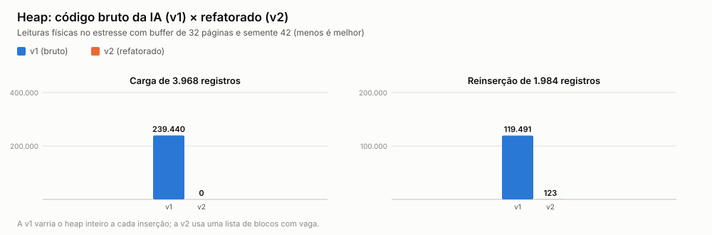
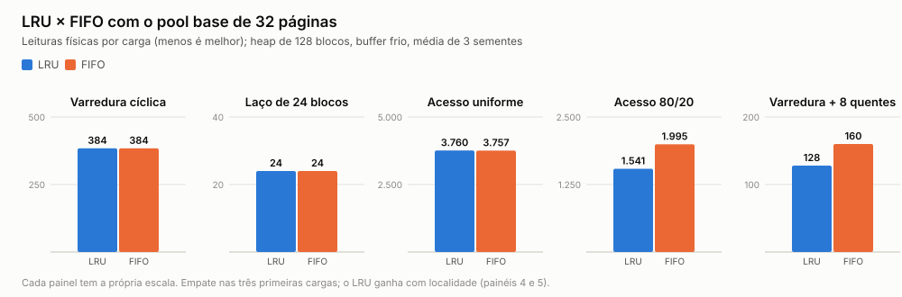
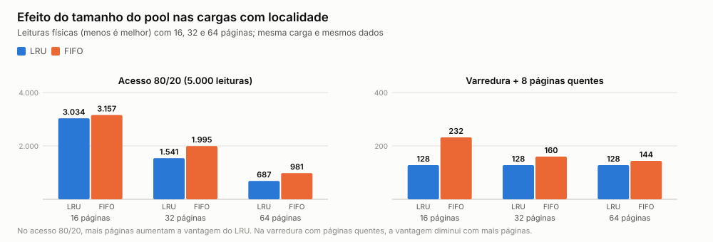

# Seção técnica — Frente 1: arquivos em blocos, buffer pool e heap

> Rascunho preparado com a IA a partir do código e das medições do repositório. Os trechos marcados com **[completar]** dependem da bancada integrada. Reescreva e confira cada número antes de entregar.

## 1. Escopo

Esta parte implementa a camada de armazenamento sobre a qual as demais frentes são medidas: o gerente de arquivos em blocos, o buffer pool com as políticas LRU e FIFO, e o arquivo heap. Todas as leituras e gravações das demais estruturas passam por `buffer.pin` e `buffer.unpin`, e os contadores de E/S física vêm do buffer.

## 2. Opções adotadas

| Item | Escolha | Justificativa |
|---|---|---|
| Tamanho do bloco | 4.096 B (4 KiB) | Padrão do grupo; o bloco n começa em n × 4.096 e novos blocos são alocados no fim. |
| Blocagem | 31 registros de 128 B por bloco | 128 B de cabeçalho de página + 31 × 128 B = 4.096 B, sem sobra. |
| Registro | 128 B, três inteiros de 64 bits (signed, little-endian) + 104 B de preenchimento | Registro fixo, conforme o plano. Campos: `aluno_id, dre, faixa_cr` (Aluno) e `inscricao_id, aluno_id, turma_id` (Inscrição). |
| Chaves | Aluno: `aluno_id` primária, `dre` única, `faixa_cr` repetida (0 a 99). Inscrição: `inscricao_id` primária, `aluno_id` estrangeira repetida. | Definidas pelo enunciado. O heap não impõe unicidade; ela fica na camada de tabela/índice. |
| Cabeçalho do arquivo (bloco 0) | assinatura `HEAPv002`, versão, tamanho do registro (128), posições por bloco (31), cabeça da lista de blocos com vaga | Permite validar o arquivo ao abrir e recuperar a lista de livres sem varrer o heap. |
| Cabeçalho de página | bytes 0–7: link para a próxima página com vaga (0 = fim); bytes 8–38: marca de ocupação das 31 posições | A marca permite excluir sem compactar e reutilizar a posição. |
| Endereço do registro | `RID(bloco, slot)`, bloco ≥ 1 | Formato compatível com o índice secundário da frente 3. |
| Reaproveitamento de espaço | lista encadeada de páginas com posição livre | Invariante: uma página está na lista se, e somente se, tem posição livre. A inserção custa uma página de dados. |
| Campo de ordenação | não se aplica (heap não ordenado) | A organização ordenada fica com a B+ (frente 2). |
| Função de hash / ordem da árvore | não se aplicam a esta frente | Hash na frente 3, B+ na frente 2. |
| Tamanho das bases | 248 registros = 8 blocos de dados; 3.968 = 128 blocos de dados | Ocupação de 100 % no heap. A menor cabe nas 16 páginas de trabalho; a maior excede. |

### Buffer pool

| Item | Escolha |
|---|---|
| Capacidade | 32 páginas de 4 KiB, uma página por bloco |
| Política base / comparação | LRU / FIFO |
| Pin | contado: cada `pin` exige um `unpin`; página fixada nunca é expulsa; com todas fixadas, `BufferFullError` |
| Dirty | quem altera os bytes passa `dirty=True` no `unpin`; a gravação ocorre na expulsão ou em `flush` explícito; página limpa nunca é gravada |
| Alocação | `allocate` reserva um bloco zerado no fim; a página entra no pool como dirty, sem leitura |
| Desabilitados | prefetch, toss-immediate e prioridade para páginas de índice ou catálogo (conforme o plano) |
| Métricas | requisições, acertos, faltas, taxa de acerto, leituras e gravações físicas, gravações por expulsão e por flush, expulsões, e leituras/gravações por tipo de arquivo (dados, índice, overflow) |

## 3. Custo estimado × custo medido

Medições: buffer de 32 páginas, política LRU, semente 42, fonte em `docs/ia/frente1/bench_v2.txt` e nos testes.

| Operação | Custo estimado | Medido | Observação |
|---|---|---|---|
| Varredura fria, base pequena | 8 leituras (8 blocos de dados) | 8 leituras | `test_scan_cost_cold` |
| Varredura fria, base grande | 128 leituras | 128 leituras | `bench_frente1.py`, fase "scan frio" |
| Carga de 3.968 registros (requisições ao buffer) | 3.968 + 2 × 128 = 4.224 | 4.224 | Cada novo bloco entra na lista de vagas (1 acesso ao bloco 0) e sai quando enche (outro). |
| Exclusão de 1.984 registros (requisições) | 1.984 + 128 = 2.112 | 2.112 | Cada um dos 128 blocos, ao deixar de estar cheio, entra na lista (1 acesso ao bloco 0). |
| Reinserção de 1.984 (requisições) | 1.984 + 128 = 2.112 | 2.112 | Cada bloco volta a encher uma vez. |
| Exclusão aleatória (leituras físicas) | cerca de 75 % × 1.984 ≈ 1.488 | 1.523 | Aproximação: o heap tem 128 blocos e o pool 32, então um bloco sorteado está no pool em cerca de 25 % dos casos. O valor medido fica 2,4 % acima, porque o pool também guarda o bloco 0. |

As requisições batem exatamente com a estimativa. As leituras físicas da exclusão aleatória seguem a estimativa por proporção de pool, não por uma conta exata.

## 4. Código bruto da IA × código refatorado

A primeira versão procurava posição livre varrendo o heap desde o bloco 1 a cada inserção. A refatoração trocou essa varredura pela lista de blocos com vaga.

| Fase (estresse) | Métrica | v1 | v2 |
|---|---|---|---|
| Carga de 3.968 | leituras físicas | 239.440 | 0 |
| | tempo | 2,679 s | 0,013 s |
| Reinserção de 1.984 | leituras físicas | 119.491 | 123 |
| | tempo | 1,555 s | 0,006 s |

Detalhes do code review (sete achados) em `docs/ia/frente1/REVISAO_E_POST_MORTEM_FRENTE1.md`.

## 5. LRU × FIFO

Fonte: `docs/ia/frente1/lru_vs_fifo.csv` e `lru_vs_fifo.md`. Mesmos dados em todas as execuções, um fator por vez (política; depois tamanho do pool), buffer frio, três sementes. Repetir com a mesma semente dá contadores idênticos (variação 0 %).

| Carga (leituras físicas, pool de 32) | LRU | FIFO |
|---|---|---|
| Varredura cíclica de 128 blocos (3 voltas) | 384 | 384 |
| Laço de 24 blocos × 20 | 24 | 24 |
| 5.000 leituras uniformes | 3.759,7 | 3.756,7 |
| 5.000 leituras, 80 % em 25 blocos | 1.541,0 | 1.995,0 |
| Varredura com 8 páginas quentes | 128 | 160 |

Leitura: sem reuso útil (varredura cíclica maior que o pool, acesso uniforme) as duas políticas empatam; quando o conjunto cabe, também. Com localidade, o LRU mantém as páginas em uso porque cada acerto as rejuvenesce, e o FIFO as expulsa pela ordem de chegada. Mais páginas reduzem as leituras muito mais do que trocar a política nas cargas aleatórias (de 16 para 64 páginas: −42 %).

**[completar]** Repetir a comparação com junções e índices na bancada integrada e comentar a diferença entre o custo teórico e o medido nos cinco cenários.

## 6. Recomendações de configuração (parte da Frente 1)

- Manter LRU como política-base: empata quando não há reuso e ganha quando há. Usar FIFO como referência da comparação.
- O heap pequeno (8 blocos) cabe no pool de 32 páginas e, depois da primeira volta, é reaproveitado. A varredura repetida do heap grande (128 blocos) não é reaproveitada com pools de 16, 32 ou 64 páginas, qualquer que seja a política (medido); só um pool com pelo menos 128 páginas a seguraria inteira, o que não foi testado.
- Manter a lista de blocos com vaga no heap sempre que houver inserções e exclusões; sem ela, cada inserção custa uma varredura do arquivo.
- **[completar]** Recomendação final por carga de trabalho (organização primária, índices e buffer), depois de integrar as demais frentes.

## 7. Limitações

Sem recuperação de falhas, transações, concorrência nem checksum; o arquivo só é consistente após `flush` ou `close`. O heap só oferece acesso por varredura. `pin` devolve a própria página, então alterar bytes sem `dirty=True` perde a escrita em silêncio (regra do contrato, coberta por testes na camada do heap). Os resultados de LRU × FIFO valem para o heap com acessos sintéticos; não substituem a medição na bancada.
